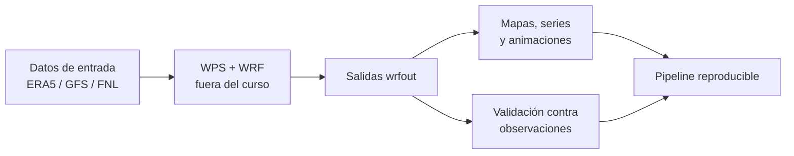

# Curso de Python aplicado al WRF — UNALM 2026

Material del curso de Python, de nivel básico a intermedio, para quienes usan
o quieren usar el modelo WRF: descargar los datos de entrada, leer y graficar
las salidas `wrfout` y validarlas contra observaciones. Son 10 clases
virtuales de 5 horas (2 h de teoría y 3 h de práctica) organizadas en 6
módulos.



## ¿Para quién es este curso?

Para estudiantes, investigadores y servidores públicos de ciencias
atmosféricas, meteorología y climatología que **usan o quieren usar el WRF**
y hoy preparan o revisan sus datos a mano.

**Lo que necesitas traer**

- **Linux básico:** moverte entre carpetas (`cd`, `ls`), entender una ruta
  como `../data/archivo.nc` y ejecutar un comando en la terminal. En clase
  se usa todo el tiempo.
- **Meteorología general:** saber qué es la temperatura a 2 m, el viento a
  10 m o un reanálisis, y por qué un modelo trabaja en UTC.
- **Experiencia básica con el WRF:** saber que el WPS prepara los datos de
  entrada y que el WRF entrega archivos `wrfout`. Haber visto (o hecho) una
  corrida alcanza.
- **Un equipo** con Linux, macOS o Windows con WSL2; 8 GB de RAM, 20 GB
  libres en disco y una conexión estable a internet.

**Lo que no necesitas**

- **Saber Python.** El Módulo 1 parte de cero. Si ya programas en otro
  lenguaje, avanzarás más rápido.
- **Saber compilar o configurar el WRF.** Correr el WPS y el WRF queda fuera
  del curso (ver el diagrama de arriba): aquí se prepara lo que entra y se
  analiza lo que sale.
- **Estadística avanzada.** Las métricas de validación (RMSE, r, KGE) se
  explican en clase, con ejemplos.

**Antes de la primera clase:** sigue la guía [`antes_del_curso.md`](antes_del_curso.md)
para instalar el entorno y crear tu cuenta de Copernicus. La cuenta puede
tardar en activarse y sin ella no se puede hacer la práctica del Día 4.

Si nunca programaste, ten a mano el [`glosario.md`](glosario.md): explica
cada término nuevo (lista, función, kernel, `DataFrame`, NaN…) en una línea.

## Cómo empezar

1. Clona el repositorio:
   ```bash
   git clone https://github.com/Japq91/wrf2026unalm.git
   cd wrf2026unalm
   ```
2. Crea el entorno (una sola vez) y actívalo (en cada sesión):
   ```bash
   conda env create -f environment.yml
   conda activate wrf2026
   ```
3. Abre Jupyter y empieza por el Módulo 1:
   ```bash
   jupyter lab
   ```

## Qué hay en cada carpeta

| Carpeta | Contenido |
|---|---|
| [`slides/`](slides/) | Las diapositivas de teoría, una por clase (`dia_01.html` … `dia_10.html`). Se abren con doble clic. |
| [`src/`](src/) | Los 6 módulos: cada uno con su `README.md` (teoría y práctica) y sus notebooks. |
| [`data/`](data/) | Datos reales de muestra (recortes de `wrfout`, ERA5, estaciones) y scripts de descarga. Ver [`data/README.md`](data/README.md). |
| [`pipeline_curso_python_wrf.md`](pipeline_curso_python_wrf.md) | El flujo técnico completo del curso, de la descarga a la validación. |
| [`glosario.md`](glosario.md) | Los términos de Python y de datos del curso, explicados para quien nunca programó. |

## Plan de clases

| Clase | Módulo | Tema |
|---|---|---|
| 1–2 | [1 — Python básico](src/modulo_01_python_basico/) | Sintaxis, NumPy, Xarray, Pandas, Matplotlib |
| 3 | [2 — Formatos de datos](src/modulo_02_formatos_datos_atmosfericos/) | NetCDF, GRIB, convenciones CF, recorte e interpolación |
| 4–5 | [3 — Descarga de datos de entrada](src/modulo_03_descarga_datos_entrada/) | ERA5, GFS, FNL, verificación de integridad |
| 6–7 | [4 — Salidas del WRF](src/modulo_04_lectura_visualizacion_wrf/) | Estructura de `wrfout`, `xwrf`, mapas, series y animaciones |
| 8–9 | [5 — Validación](src/modulo_05_validacion_resultados/) | RMSE, MAE, r, KGE, *added value*, diagrama de Taylor |
| 10 | [6 — Pipeline integrado](src/modulo_06_pipeline_integrado/) | Proyecto final: tu propio pipeline reproducible |

## Al cerrar cada clase

La última diapositiva de cada día tiene un código QR a la **bitácora de la
sesión**: un formulario de 2 minutos sobre lo que te costó y si se resolvió.
Con esas respuestas se ajusta la clase siguiente.
